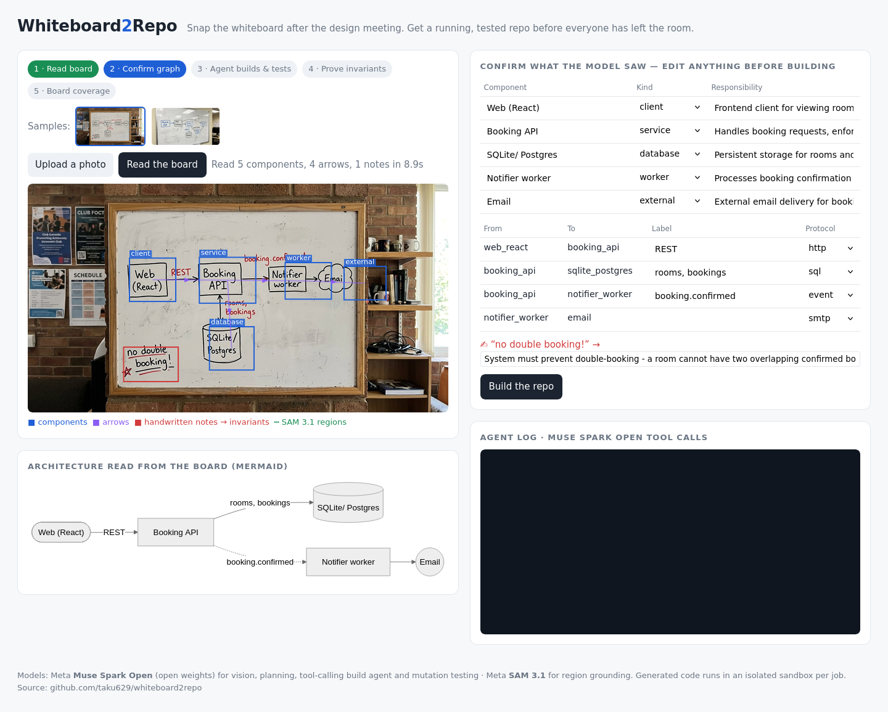
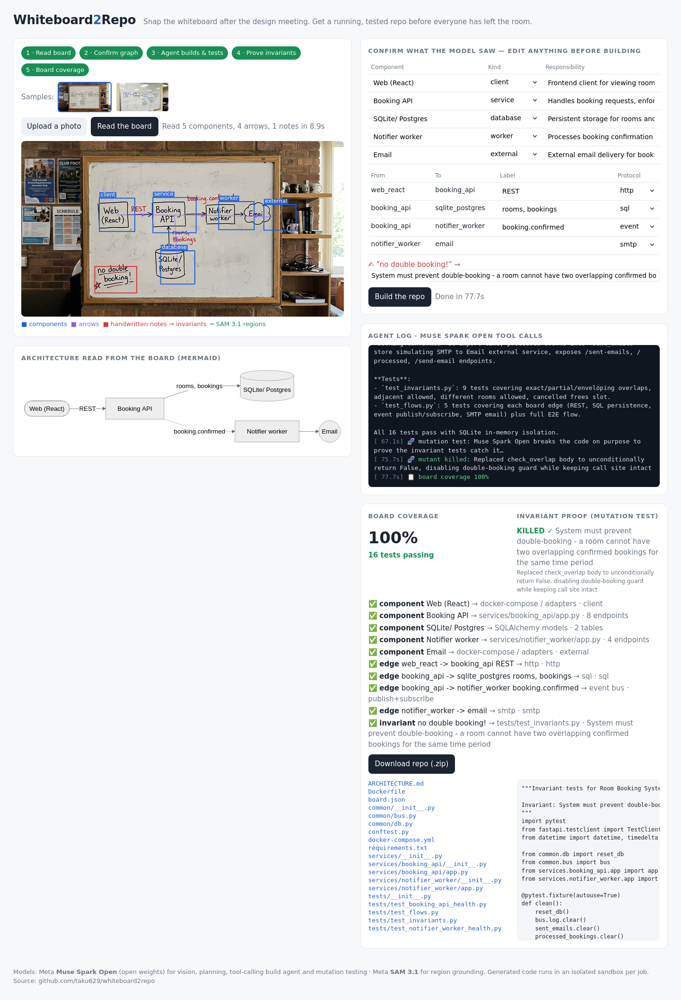
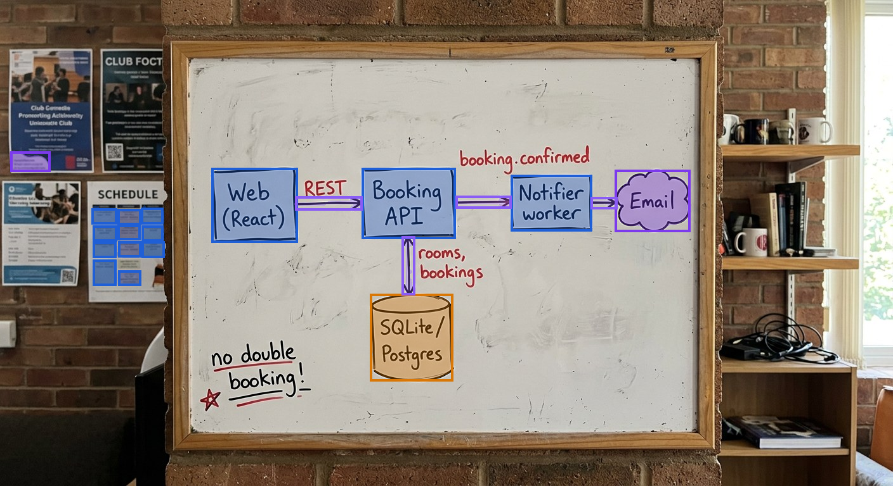

# Whiteboard2Repo

**Snap the whiteboard after the design meeting. Get a running, tested repo before everyone has left the room.**

Built for the Meta Global AI Developer Hackathon (Nov 2026) · Track: Build for Your World · Solo · Everything in this repo was written during the hackathon.




SAM 3.1 regions on the sample board (boxes, cylinder, cloud, arrows):



## The problem

Every system starts as boxes and arrows on a whiteboard. Then someone takes a phone photo, it rots in a chat thread, and a day later an engineer re-types the same design into boilerplate by hand: services, a database, a queue, a compose file, tests. The constraints people wrote in the corner ("no double booking!") are the first thing to get lost.

## What it does

1. **Read the board** – Meta **Muse Spark Open** looks at the photo and returns a typed graph: components (client / service / database / worker / queue / external) with bounding boxes, every arrow with its label and protocol, and the handwritten notes. Each note is rewritten as a testable **invariant**. Optional Meta **SAM 3.1** segmentation regions are passed in as grounding hints.
2. **Confirm** – you see the boxes drawn over your photo, a Mermaid diagram, and an editable table. Fix anything the model misread before building.
3. **Build** – a deterministic scaffolder emits a green skeleton (FastAPI per service, SQLAlchemy models, an event bus, `docker-compose.yml`, Dockerfile). Then a Muse Spark Open **tool-calling agent** (`list_files`, `read_file`, `write_file`, `run_tests`) implements every endpoint and edge and writes tests until `pytest` is green.
4. **Prove the invariants** – for each invariant the model plays a mutation-testing engine: it injects the smallest change that would break that rule, the tests run, and the mutant must be **KILLED**. Then the code is restored. A rule only counts as covered when breaking it makes the tests fail.
5. **Board coverage** – every box, arrow and note on the board is checked against the generated repo: services need ≥2 endpoints, databases need SQLAlchemy models, event edges need publish + subscribe, notes need invariant tests. It is a structural check, not a semantic proof; the mutation step is the semantic check. Download the repo as a zip.
6. **Re-snap** – the design changed? Photograph the board again. Muse Spark Open reads the new photo, `app/diff.py` diffs it against the board the repo was built from (components matched by id, label similarity and their connections, so a relabelled box keeps its code), and the diff is shown on the Mermaid diagram (green added / red removed / amber changed). **Apply update** runs the agent with only the diff: new services get a skeleton, removed ones are deleted, the agent wires new edges and writes tests for new rules while every existing test stays green, and only the **new** invariants go through the mutation proof. The run ends with a changed-files list; board history is kept as `graph.v1.json`, `graph.v2.json`, …

## Re-snap

`samples/board_rooms_v2.jpg` is the same board after the team added a **Payments API** and the rule **"max 3 active bookings per user!"** (also an AI-generated test image). Build `board_rooms` first, then pick the updated sample under *Re-snap*.

API: `POST /api/resnap/{job_id}` (photo or sample) → diff + Mermaid; `POST /api/update/{job_id}` → SSE stream of the incremental update.

Example run (board_rooms sample, 2026-11-03): build 84 s → 13 tests passing, board coverage 100 %, "no double booking" mutant KILLED. Re-snap with board_rooms_v2: update 199 s → 18 tests passing, coverage 100 %, new "max 3 active bookings" mutant KILLED. Times vary by run and endpoint load.

## Meta models used

| Model | Where | Why |
|---|---|---|
| **Muse Spark Open** (open weights) | `app/vision.py`, `app/agent.py` | One model for vision (sketch → graph + bboxes + notes), planning, multi-step tool calling, and adversarial mutation. Open weights means a team can self-host it next to their code (this demo calls it through a hosted endpoint, so photos are sent to that provider). |
| **SAM 3.1** (open weights) | `sam/sam31_regions.py` | Text-prompted segmentation ("rectangle box", "cylinder", "arrow", "handwritten text") gives pixel regions that ground the graph read. Run on a free Kaggle T4 GPU (~90 s for both boards); results are cached as `samples/*.sam.json` with overlays in `samples/*.sam.png`. SAM runs offline (it needs a GPU), so in the app only the sample boards carry SAM regions; uploaded photos are read by Muse Spark Open alone, and the UI says which mode was used. Off-board hits (posters on the wall) are passed as hints only — Muse Spark Open decides what belongs to the diagram. |

Muse Spark Open is called through any OpenAI-compatible endpoint (we used Nebius Token Factory). Nothing is hard-wired to one provider.

## Run it

```bash
pip install -r requirements.txt coverage
export MUSE_API_KEY=...            # key for an OpenAI-compatible endpoint serving Muse Spark Open
# optional: MUSE_BASE_URL (default https://api.tokenfactory.nebius.com/v1), MUSE_MODEL (default meta-models/muse-spark-open)
uvicorn app.main:app --port 8765
```

Open http://localhost:8765, pick a sample or upload a photo. Or with Docker: `docker build -t w2r . && docker run -p 8000:8000 -e MUSE_API_KEY=... w2r`.

Offline tests (no model needed): `pytest tests`.

## Layout

```
app/llm.py        OpenAI-compatible client for Muse Spark Open (vision + tools)
app/vision.py     photo -> graph JSON (components, edges, notes -> invariants), Mermaid
app/scaffold.py   deterministic, always-green skeleton generator
app/agent.py      tool-calling build loop, re-snap update loop, mutation proof, board coverage
app/diff.py       re-snap: board-to-board diff, id alignment, diff Mermaid
app/main.py       FastAPI + SSE progress stream
app/static/       single-page UI
sam/              SAM 3.1 region extraction script (GPU or >=8 GB CPU)
samples/          demo boards + cached graph reads
```

## Honest notes

- The two sample whiteboards in `samples/` are **AI-generated test images**, not photos of a real meeting. Upload your own photo to try a real board.
- Generated code runs in a temporary directory per job. For a public deployment, run builds in a container sandbox.
- Mutation proof needs the model to cooperate; if it refuses or the mutant survives, the UI says so instead of claiming coverage.

## License

MIT
